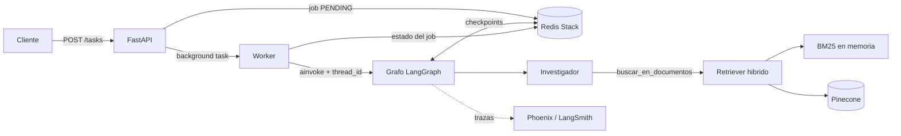
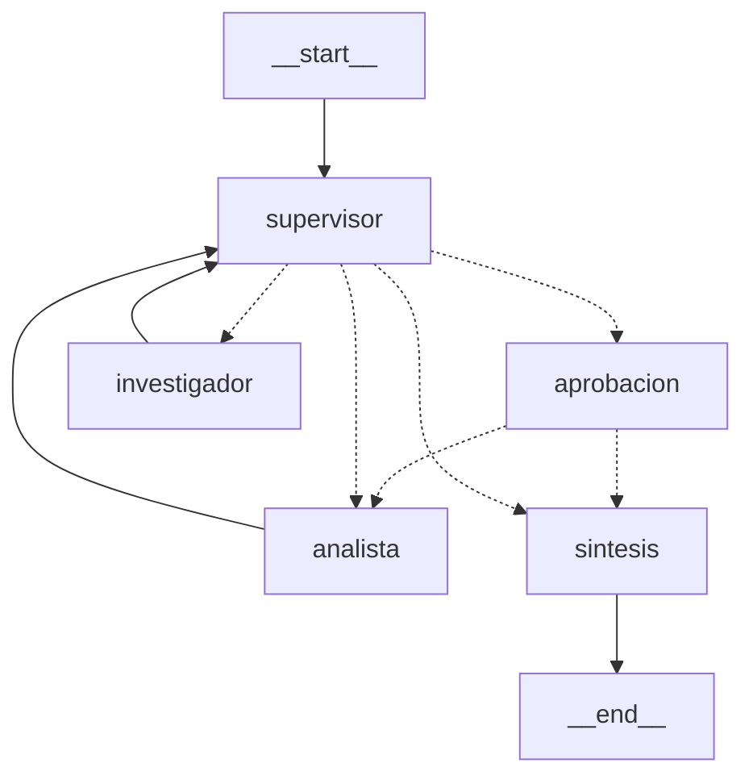

# Intelligence System

Entrega final. Un sistema que junta RAG hibrido (BM25 + Pinecone), un
orquestador multi-agente con supervisor (LangGraph), una API FastAPI
asincrona con estado en Redis, aprobacion humana para tareas criticas y
trazas en Arize Phoenix o LangSmith. Python 3.12+.

## Informe de tests

**[docs/INFORME_TESTS.md](docs/INFORME_TESTS.md)** (tambien en PDF: [docs/INFORME_TESTS.pdf](docs/INFORME_TESTS.pdf)): resultados, cobertura (93 %), capturas, trazas en Phoenix, corrida real con Gemini y bugs encontrados.

**[docs/REVISION_OPENCODE.md](docs/REVISION_OPENCODE.md)**: revision de codigo hecha con OpenCode (salida textual y como reproducirla).

## Verificacion rapida (sin API keys, sin Docker)

```bash
./run_tests.sh
```

Crea el entorno, instala dependencias y corre **61 tests** (59 sin Redis, los
2 de integracion con Redis Stack se saltean solos). Deja el resultado en
`reports/test_report.txt` y `reports/junit.xml`. Los tests usan un LLM falso
con guion, asi que validan la logica del sistema, no la calidad de un modelo
real (ver `reports/README.md` para el alcance exacto).

## Donde esta cada cosa

| Criterio | Que mirar | Evidencia |
| --- | --- | --- |
| Arquitectura y coherencia | RAG (`app/rag/`) + agentes (`app/agents/`, `app/graph.py`) + API (`app/main.py`, `app/worker.py`) unidos en un solo flujo, diagramas abajo | `tests/test_graph.py`, `tests/test_api.py` |
| Asincronia y validacion | Nodos, worker y endpoints `async`; Pydantic en API y herramientas (`app/schemas.py`); sin `requests` ni llamadas bloqueantes dentro de `async def` | `tests/test_estandares.py`, `tests/test_schemas.py`, `tests/test_tools.py` |
| Persistencia y observabilidad | `AsyncRedisSaver` (checkpoints) + estado de jobs en Redis; trazas a Phoenix/LangSmith con `job_id` en los metadatos | `tests/test_integracion_redis.py`, `reports/phoenix_trazas_resumen.json`, `reports/gemini_real.md` (corrida real con Gemini), `screenshots/` |
| Documentacion y despliegue | Este README, diagramas, `./run.sh` (un solo comando), `docker-compose.yml`, `/docs` de la API | `reports/compose_report.txt` |
| Entorno y estandares | `pyproject.toml` (`requires-python >=3.12`), `.python-version`, `requirements*.txt`, `.env.example` (nada hardcodeado), `ruff` | `reports/lint_report.txt` |

## Levantar todo (una sola instruccion)

Requiere Docker y las API keys en `.env`.

```bash
./run.sh
```

La primera vez crea `.env` desde `.env.example` y se detiene para que
completes las keys: `GOOGLE_API_KEY` (Gemini, gratis, ver mas abajo) y
`PINECONE_API_KEY`. Despues de completarlas, volver a correr `./run.sh`.

Eso levanta con `docker compose up --build`:

- `redis`: Redis Stack (estado de jobs + checkpoints de LangGraph, con
  persistencia en disco).
- `phoenix`: dashboard de trazas en http://localhost:6006.
- `ingest`: crea el indice de Pinecone si no existe y sube `data/` (no
  reindexa si el namespace ya tiene vectores).
- `app`: la API en http://localhost:8000 (documentacion en `/docs`).

## Probar con modelo real

```bash
pip install httpx
python scripts/pruebas.py
```

Corre 7 pruebas contra la API: pregunta RAG, RAG + sentimiento, calculo de
costo, tarea critica aprobada, tarea critica rechazada, memoria entre turnos
con `conversation_id`, y validacion de entrada invalida (422). Guarda el
resultado en `pruebas_resultado.json` y cada ejecucion queda trazada en
Phoenix.

Sin keys, `python -m scripts.demo_trazas_offline` (con `docker compose up -d
redis phoenix`) corre esas mismas 7 pruebas con un LLM con guion y deja
trazas reales en Phoenix: asi se generaron las capturas de `screenshots/`.

## API

- `POST /tasks` `{"texto": "...", "conversation_id": "opcional"}` -> `202`
  con `job_id` y `thread_id`. No bloquea: la tarea corre en background.
- `GET /tasks/{job_id}` -> estado: `PENDING`, `RUNNING`,
  `WAITING_APPROVAL`, `DONE` o `FAILED` (con respuesta, fuentes y aporte de
  cada agente).
- `POST /tasks/{job_id}/approve` `{"aprobado": true|false}` -> retoma una
  tarea pausada (`409` si el job no esta esperando aprobacion).
- `GET /health` -> chequea la conexion con Redis.

Todas las entradas y salidas estan validadas con Pydantic (`app/schemas.py`),
incluidos los argumentos y resultados de las herramientas de los agentes.

## Arquitectura



## Diagrama del grafo



- `supervisor`: decide con una salida estructurada (Pydantic) si interviene
  el investigador, el analista, o si ya se puede cerrar. Su prompt tiene una
  rubrica y hay un tope de `MAX_PASOS` para evitar loops.
- `investigador`: busca en la base de conocimiento con `buscar_en_documentos`
  (RAG hibrido).
- `analista`: `analizar_sentimiento` y `calcular_costo_tokens`.
- `aprobacion`: si el texto del usuario menciona algo critico (`critico`,
  `produccion`, `alto costo`, `importante`), el grafo se pausa antes del
  analista (`interrupt`) hasta que alguien llame a `/approve`. Si se rechaza,
  el analista no se ejecuta.
- `sintesis`: arma la respuesta final con las fuentes citadas.

## Persistencia y memoria

El checkpointer es `AsyncRedisSaver` (Redis Stack con persistencia
`appendonly`). Las conversaciones se guardan por `thread_id`
(`conversation_id` o el `job_id`), asi que si se reinicia la API (o todo el
compose) los jobs y las conversaciones siguen ahi. Los tests de
`tests/test_integracion_redis.py` lo comprueban abriendo un checkpointer
nuevo contra el mismo Redis, como pasaria tras un reinicio.

## Observabilidad

- Phoenix: el compose lo activa solo (`PHOENIX_ENABLED=true`). Cada tarea
  genera una traza con un span por nodo, llamada al LLM y herramienta, y
  queda etiquetada con `job_id` y `thread_id` en los metadatos.
- LangSmith: poner `LANGCHAIN_TRACING_V2=true` y `LANGCHAIN_API_KEY` en
  `.env` (y `PHOENIX_ENABLED=false`).
- Logs: cada paso del supervisor, aporte de agentes y cambio de estado de
  un job queda en el log con el `job_id`.

## Usar Gemini (tier gratuito)

Es el proveedor por defecto (LLM y embeddings), asi no hace falta pagar
OpenAI ni Anthropic:

1. Crear una key gratis en https://aistudio.google.com/apikey.
2. Pegarla en `.env` como `GOOGLE_API_KEY` (el resto de las variables de
   Gemini ya vienen en `.env.example`).
3. `./run.sh`. Sin Pinecone: poner `VECTOR_STORE=memory` en `.env` y alcanza
   con la key de Gemini (los documentos se indexan en memoria al arrancar).

Que hay que saber:

- **Privacidad:** segun la pagina de precios de Google, en el tier gratuito
  el contenido que se envia se usa para mejorar sus productos. No mandar datos
  sensibles. Los documentos de `data/` son de ejemplo, no hay problema.
- **Limites (medidos en una corrida real):** el cupo es por modelo y por
  proyecto. Para `gemini-3.6-flash` Google devolvio 429 con
  `GenerateRequestsPerDayPerProjectPerModel-FreeTier = 20` y
  `GenerateRequestsPerMinutePerProjectPerModel-FreeTier = 5`. Cada tarea usa
  entre 5 y 8 pedidos al LLM, asi que con un solo modelo entran ~3 tareas por
  dia. Como el cupo es por modelo, se puede repartir cambiando `GOOGLE_MODEL`
  (los modelos gratuitos estan en la pagina de precios de Google). Tambien
  aparecen 503 ("high demand") en horas pico: el cliente reintenta hasta
  `GOOGLE_MAX_RETRIES` veces y, si igual falla, el job queda en `FAILED` con
  el error (nunca colgado). El cupo diario se renueva a medianoche (hora del
  Pacifico).
- **Embeddings:** `gemini-embedding-2` no acepta `task_type` y, si se le pasa
  una lista de textos, devuelve un solo embedding agregado. Por eso
  `app/rag/embeddings.py` tiene un wrapper propio (un `Content` por texto,
  prefijos de documento/consulta y chequeo de que vuelva un embedding por
  texto). Se usa dimension 768, asi que el indice de Pinecone tiene que ser de
  768: si `INDEX_NAME` ya existe con otra dimension, `ingest` falla con un
  mensaje claro (usar otro `INDEX_NAME` o borrar el indice).
- Los modelos gratuitos cambian con el tiempo: si `gemini-3.5-flash-lite` deja de
  estar disponible, cambiar `GOOGLE_MODEL`.
- Para volver a un proveedor de pago: `LLM_PROVIDER=anthropic|openai` y/o
  `EMBEDDING_PROVIDER=openai` (ver los comentarios de `.env.example`).

## Variables de entorno

Nada de indices ni modelos esta fijo en el codigo: `INDEX_NAME`,
`PINECONE_NAMESPACE`, `EMBEDDING_MODEL`, `GOOGLE_MODEL`, `ANTHROPIC_MODEL`, `OPENAI_MODEL`,
`MAX_PASOS`, `TOP_K`, etc. Ver `.env.example`.

## Estructura

- `app/main.py`: API FastAPI.
- `app/worker.py`: corre y retoma tareas en background, estado en Redis
  (incluido `FAILED` si algo explota).
- `app/graph.py`, `app/state.py`, `app/hitl.py`: grafo, estado compartido y
  aprobacion humana.
- `app/agents/`: investigador y analista con sus herramientas.
- `app/rag/`: chunking, ingesta a Pinecone, embeddings (Gemini/OpenAI), retriever hibrido y servicio.
- `app/jobs.py`: estado de los jobs en Redis.
- `app/schemas.py`: modelos Pydantic.
- `app/observability.py`: logs y trazas.
- `scripts/pruebas.py`: las pruebas contra la API con modelo real.
- `scripts/demo_trazas_offline.py`: las mismas pruebas con LLM con guion.
- `tests/`: suite pytest. `reports/`: evidencia generada.
- `data/`: documentos de ejemplo que se indexan.

## Capturas (`screenshots/`)

Las capturas incluidas son de Phoenix con las trazas del demo offline
(LLM con guion, por eso costo `$0` y sin tokens). Las capturas de costo por
ejecucion y latencia con tokens reales necesitan una corrida con las API
keys (ver `screenshots/README.md`).
