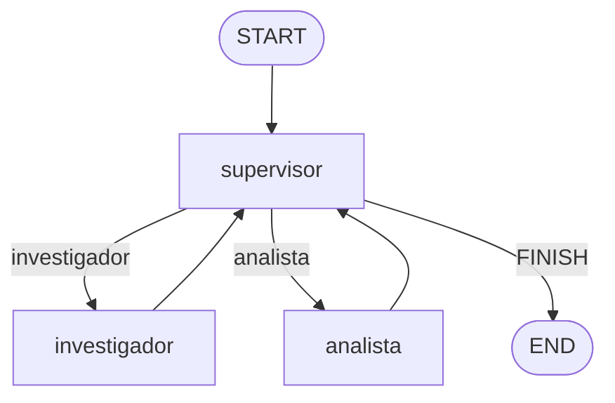

# Orquestador multi-agente (Supervisor)

Pre-entrega 6. Supervisor que reparte una consulta entre 2 especialistas
(investigador y analista) hasta juntar suficiente info para responder.

## Instalacion

```bash
python3 -m venv .venv
source .venv/bin/activate
pip install -r requirements.txt
```

## Configuracion

Copiar `.env.example` a `.env`. `LLM_PROVIDER` puede ser `anthropic` u
`openai`.

## Uso

```bash
python main.py
```

Guarda la traza en `trace_ejecucion.json` (contribuciones de cada agente +
respuesta final).

## Estructura

- `state.py`: estado compartido (`EstadoOrquestador`), extiende
  `MessagesState` con `next_agent`, `task_completed`, `pasos` y
  `contribuciones` (quien aporto que).
- `agents/research_agent.py`: agente investigador, tool `buscar_info`
  (busqueda simulada sobre docs de pre-entregas anteriores).
- `agents/analyst_agent.py`: agente analista, tool `analizar_sentimiento`
  (heuristica simple por palabras clave).
- `graph.py`: `StateGraph` con nodo supervisor + los 2 especialistas.
- `main.py`: corre una consulta de ejemplo y guarda la traza.

## Topologia

Supervisor jerarquico: un nodo central decide a que especialista mandar la
tarea, en vez de que los agentes se llamen entre si. Cada especialista solo
ve los mensajes de la conversacion, no metadata interna del grafo, asi no
se contamina el contexto.

El supervisor corta el loop de 2 formas: su prompt le pide FINISH recien
cuando ya hay info buscada Y analizada, y ademas hay un tope de `MAX_PASOS`
(6) por si el LLM no decide terminar solo.

## Diagrama



## trace_ejemplo.json

Ejemplo ilustrativo del formato (armado a mano, sin API key en esta
maquina). El resultado de `buscar_info` si es real, es deterministico.
Corriendo `main.py` con tu key se genera `trace_ejecucion.json` real.
