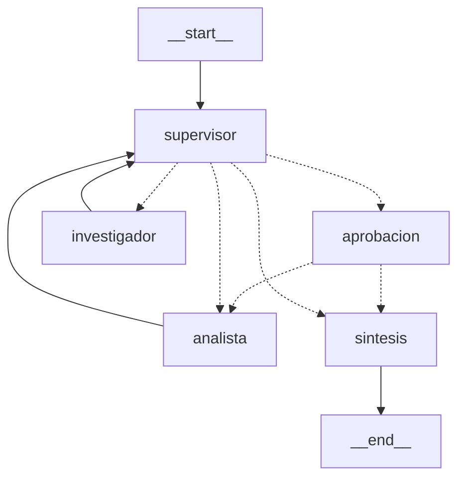

# Intelligence System

Entrega final. Un sistema que junta RAG hibrido (BM25 + Pinecone), un
orquestador multi-agente con supervisor (LangGraph), una API FastAPI
asincrona con estado en Redis, aprobacion humana para tareas criticas y
trazas en Arize Phoenix o LangSmith.

## Levantar todo (una sola instruccion)

Requiere Docker y las API keys en `.env`.

```bash
./run.sh
```

La primera vez crea `.env` desde `.env.example` y se detiene para que
completes las keys (`OPENAI_API_KEY` es obligatoria siempre porque se usa
para los embeddings, mas `ANTHROPIC_API_KEY` si `LLM_PROVIDER=anthropic`, y
`PINECONE_API_KEY`). Despues de completarlas, volver a correr `./run.sh`.

Eso levanta con `docker compose up --build`:

- `redis`: Redis Stack (estado de jobs + checkpoints de LangGraph, con
  persistencia en disco).
- `phoenix`: dashboard de trazas en http://localhost:6006.
- `ingest`: crea el indice de Pinecone si no existe y sube `data/` (no
  reindexa si el namespace ya tiene vectores).
- `app`: la API en http://localhost:8000 (documentacion en `/docs`).

## Probar

```bash
pip install httpx
python scripts/pruebas.py
```

Corre 7 pruebas contra la API: pregunta RAG, RAG + sentimiento, calculo de
costo, tarea critica aprobada, tarea critica rechazada, memoria entre turnos
con `conversation_id`, y validacion de entrada invalida (422). Guarda el
resultado en `pruebas_resultado.json` y cada ejecucion queda trazada en
Phoenix.

## API

- `POST /tasks` `{"texto": "...", "conversation_id": "opcional"}` -> `202`
  con `job_id` y `thread_id`. No bloquea: la tarea corre en background.
- `GET /tasks/{job_id}` -> estado: `PENDING`, `RUNNING`,
  `WAITING_APPROVAL`, `DONE` o `FAILED` (con respuesta, fuentes y aporte de
  cada agente).
- `POST /tasks/{job_id}/approve` `{"aprobado": true|false}` -> retoma una
  tarea pausada (`409` si el job no esta esperando aprobacion).
- `GET /health` -> chequea la conexion con Redis.

Todas las entradas y salidas estan validadas con Pydantic (`app/schemas.py`),
incluidos los argumentos y resultados de las herramientas de los agentes.

## Diagrama del grafo



- `supervisor`: decide con una salida estructurada (Pydantic) si interviene
  el investigador, el analista, o si ya se puede cerrar. Su prompt tiene una
  rubrica y hay un tope de `MAX_PASOS` para evitar loops.
- `investigador`: busca en la base de conocimiento con `buscar_en_documentos`
  (RAG hibrido).
- `analista`: `analizar_sentimiento` y `calcular_costo_tokens`.
- `aprobacion`: si el texto del usuario menciona algo critico (`critico`,
  `produccion`, `alto costo`, `importante`), el grafo se pausa antes del
  analista (`interrupt`) hasta que alguien llame a `/approve`. Si se rechaza,
  el analista no se ejecuta.
- `sintesis`: arma la respuesta final con las fuentes citadas.

## Persistencia y memoria

El checkpointer es `AsyncRedisSaver` (Redis Stack con persistencia
`appendonly`). Las conversaciones se guardan por `thread_id`
(`conversation_id` o el `job_id`), asi que si se reinicia la API (o todo el
compose) los jobs y las conversaciones siguen ahi.

## Observabilidad

- Phoenix: el compose lo activa solo (`PHOENIX_ENABLED=true`). Cada tarea
  genera una traza con un span por nodo, llamada al LLM y herramienta, y
  queda etiquetada con `job_id` y `thread_id` en los metadatos.
- LangSmith: poner `LANGCHAIN_TRACING_V2=true` y `LANGCHAIN_API_KEY` en
  `.env` (y `PHOENIX_ENABLED=false`).
- Logs: cada paso del supervisor, aporte de agentes y cambio de estado de
  un job queda en el log con el `job_id`.

## Variables de entorno

Nada de indices ni modelos esta fijo en el codigo: `INDEX_NAME`,
`PINECONE_NAMESPACE`, `EMBEDDING_MODEL`, `ANTHROPIC_MODEL`, `OPENAI_MODEL`,
`MAX_PASOS`, `TOP_K`, etc. Ver `.env.example`.

## Estructura

- `app/main.py`: API FastAPI.
- `app/worker.py`: corre y retoma tareas en background, estado en Redis
  (incluido `FAILED` si algo explota).
- `app/graph.py`, `app/state.py`, `app/hitl.py`: grafo, estado compartido y
  aprobacion humana.
- `app/agents/`: investigador y analista con sus herramientas.
- `app/rag/`: chunking, ingesta a Pinecone, retriever hibrido y servicio.
- `app/jobs.py`: estado de los jobs en Redis.
- `app/schemas.py`: modelos Pydantic.
- `app/observability.py`: logs y trazas.
- `scripts/pruebas.py`: las pruebas contra la API.
- `data/`: documentos de ejemplo que se indexan.

## screenshots/

Pendientes: hacen falta las keys reales para una corrida real (ver
`screenshots/README.md`).
