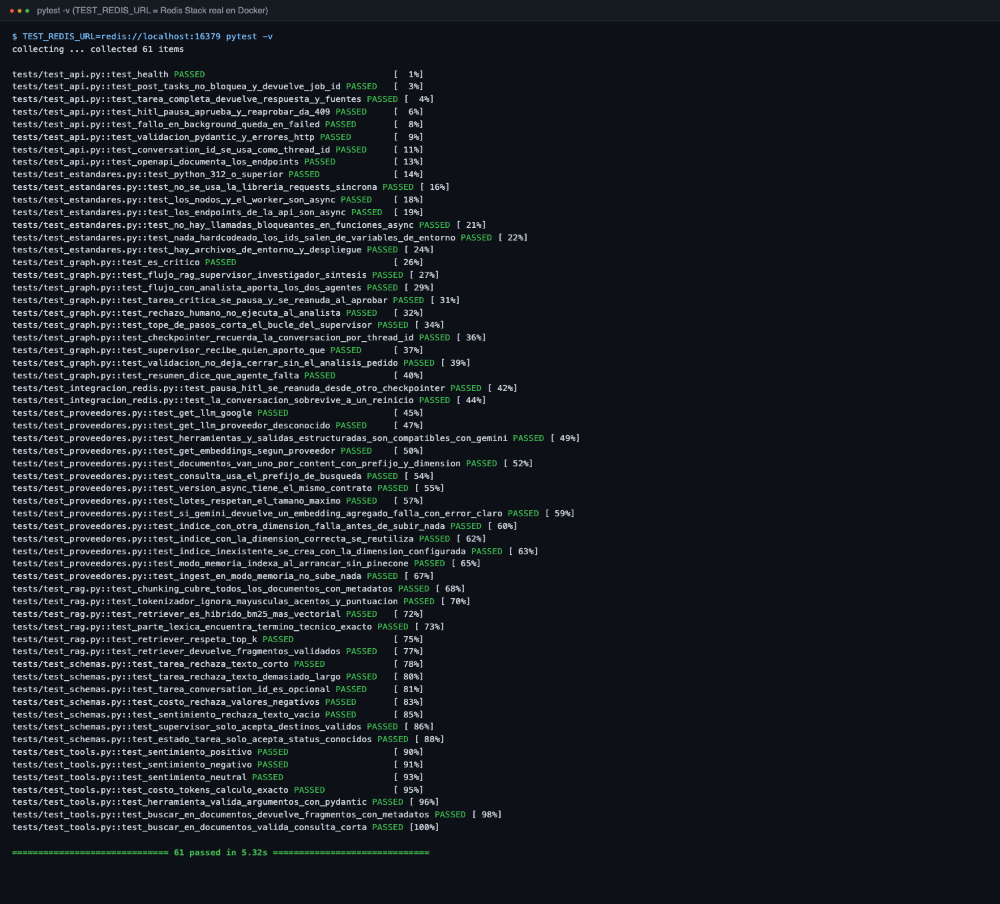
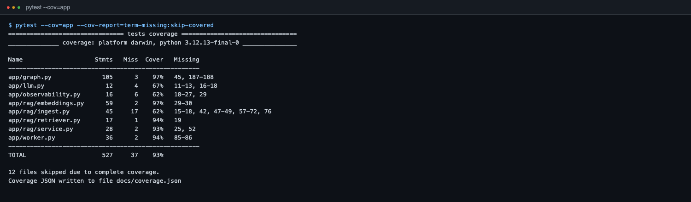
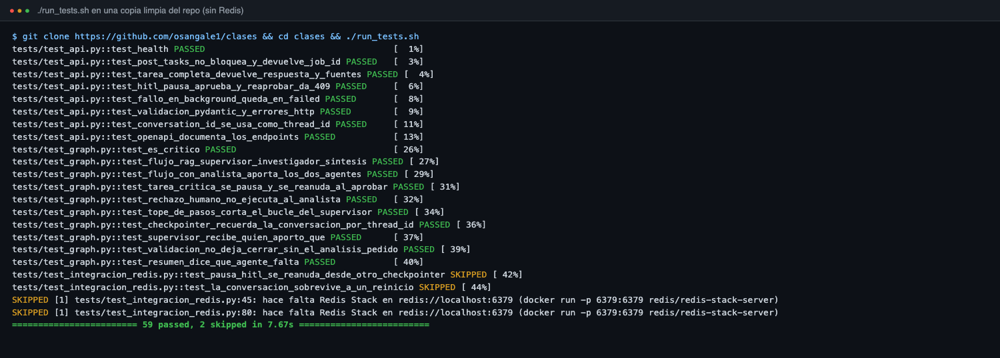
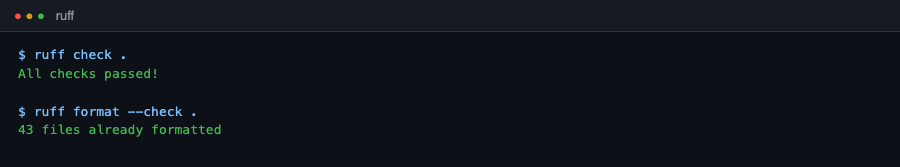
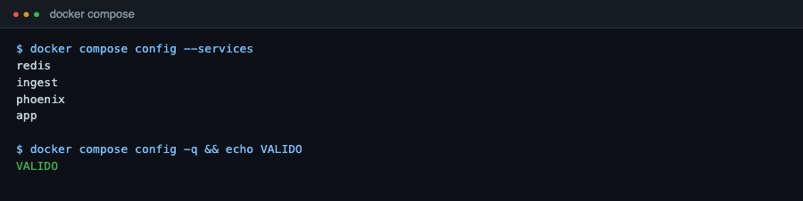
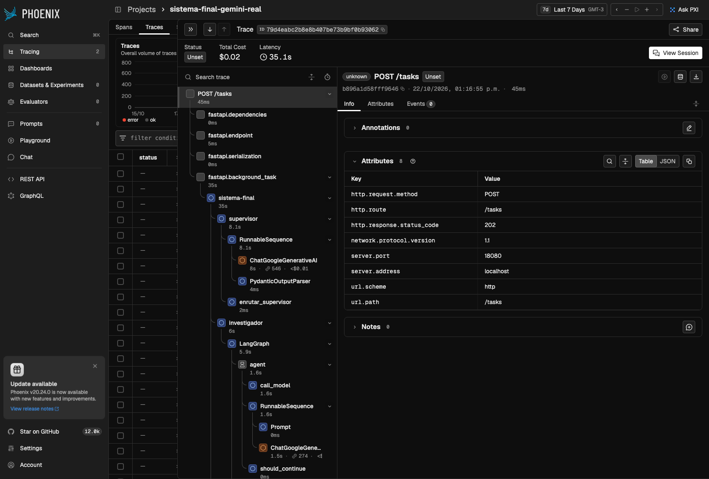
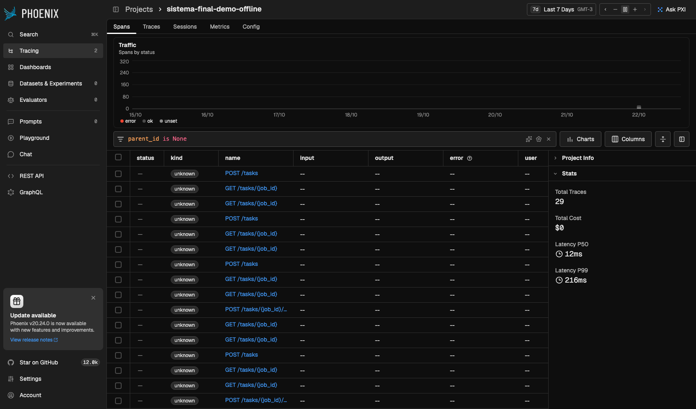
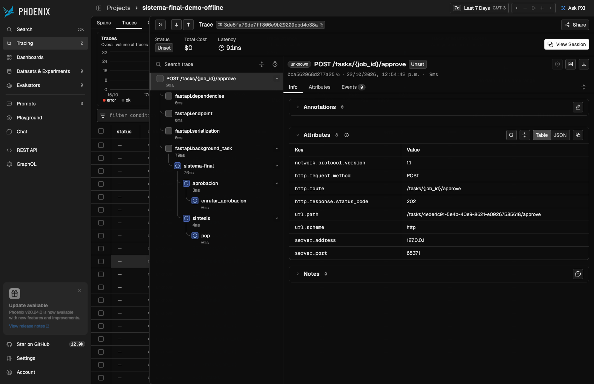

# Informe de tests - Intelligence System

Entrega final. Fecha de la corrida: 2026-10-22. Repositorio: https://github.com/osangale1/clases
(rama `entregable-final`).

## 1. Resumen

| Verificacion | Resultado |
| --- | --- |
| Suite de tests (pytest) | **61 de 61 pasan** (incluye 2 de integracion contra Redis Stack real) |
| Cobertura de `app/` | **93 %** (527 sentencias, 37 sin cubrir) |
| Corrida en una copia limpia, sin Redis | 59 pasan, 2 se saltean solos (los de integracion) |
| Lint (`ruff check`, `ruff format --check`) | Sin errores |
| `docker-compose.yml` | Valido (servicios `redis`, `ingest`, `phoenix`, `app`) |
| Trazas en Arize Phoenix | 7 pruebas trazadas (LLM con guion) + corrida real con Gemini |
| Corrida real con Gemini (tier gratuito) | RAG por la API `DONE`, tarea investigador + analista `DONE` |

## 2. Como reproducirlo

```bash
git clone https://github.com/osangale1/clases && cd clases
./run_tests.sh                                   # 59 pasan + 2 skipped (no necesita keys ni Docker)

docker run -d -p 6379:6379 redis/redis-stack-server
TEST_REDIS_URL=redis://localhost:6379 ./run_tests.sh   # 61 pasan
```

`run_tests.sh` crea el entorno virtual (Python 3.12), instala `requirements-dev.txt`, corre pytest
y deja el resultado en `reports/test_report.txt` y `reports/junit.xml`.

## 3. Entorno

- Python 3.12.13, macOS (arm64).
- pytest 9.1, pytest-asyncio 1.4 (`asyncio_mode = auto`), fakeredis 2.40, pytest-cov.
- Redis Stack (`redis/redis-stack-server`) y Arize Phoenix (`arizephoenix/phoenix`) en Docker.

## 4. Que cubre cada archivo de tests

| Archivo | Tests | Que verifica |
| --- | --- | --- |
| `tests/test_api.py` | 8 | API real levantada con uvicorn: `POST /tasks` devuelve 202 en menos de 0.5 s sin esperar la tarea, flujo completo con respuesta y fuentes, pausa humana + aprobacion + 409 al reaprobar, fallo en background queda en `FAILED`, validacion 422/404, `conversation_id` como `thread_id`, OpenAPI |
| `tests/test_graph.py` | 10 | Grafo LangGraph: supervisor -> investigador -> sintesis, flujo con analista, pausa y reanudacion (HITL), rechazo humano no ejecuta al analista, tope de pasos, memoria por `thread_id`, el supervisor recibe quien aporto que, validacion que no deja cerrar sin el analisis pedido |
| `tests/test_integracion_redis.py` | 2 | Contra Redis Stack real: una pausa HITL se retoma desde otra conexion del checkpointer (simula reinicio) y la conversacion sobrevive al reinicio |
| `tests/test_proveedores.py` | 14 | Gemini: seleccion de proveedor, esquemas de herramientas y salidas estructuradas compatibles, embeddings un `Content` por texto con prefijos y dimension, lotes, error si vuelve un embedding agregado, chequeo de dimension del indice de Pinecone, modo `VECTOR_STORE=memory` |
| `tests/test_rag.py` | 6 | Chunking con metadatos (fuente, pagina, categoria), tokenizador BM25, retriever hibrido BM25 + vectorial, `top_k` |
| `tests/test_tools.py` | 7 | Herramientas de los agentes: sentimiento, costo de tokens, busqueda RAG con metadatos, validacion Pydantic de argumentos |
| `tests/test_schemas.py` | 7 | Modelos Pydantic de la API y del supervisor: rechazan datos invalidos |
| `tests/test_estandares.py` | 7 | Python >= 3.12, sin `requests` sincrono, nodos/worker/endpoints `async`, sin llamadas bloqueantes dentro de `async def`, nada hardcodeado, archivos de entorno y despliegue presentes |

Un control extra corre en **todos** los tests: ninguna llamada al LLM puede terminar en un mensaje del
asistente (los modelos Claude nuevos lo rechazan con 400; fue un bug real de entregas anteriores).

## 5. Capturas

### 5.1 Suite completa con Redis Stack real (61 de 61)



### 5.2 Cobertura



Lo que queda sin cubrir es codigo que depende de servicios externos con cuenta: la creacion real del
indice en Pinecone (`ingest.py`), el registro del colector de Phoenix (`observability.py`) y las ramas
de OpenAI/Anthropic en `llm.py` (el proveedor por defecto, Gemini, si esta cubierto).

### 5.3 Copia limpia del repo, sin Redis ni API keys



### 5.4 Lint y despliegue





## 6. Trazabilidad (Arize Phoenix)

Corrida real con Gemini (`gemini-3.6-flash`): traza de `POST /tasks` con el supervisor, el
investigador y la herramienta RAG, con tokens reales y 35 s de latencia. El costo que muestra Phoenix
es una estimacion con precio de lista; en el tier gratuito no se cobra.



Las 7 pruebas de `scripts/demo_trazas_offline.py` contra la API real, Redis y Phoenix (LLM con guion,
por eso costo $0): 29 trazas, con spans de supervisor, investigador, analista, aprobacion, sintesis,
herramientas y del retriever hibrido (`EnsembleRetriever` -> `BM25Retriever` + `VectorStoreRetriever`).



Rechazo humano de una tarea critica (`aprobacion` -> `enrutar_aprobacion` -> `sintesis`):



## 7. Corrida real con Gemini

Detalle completo en `reports/gemini_real.md`.

| Que se corrio | Resultado |
| --- | --- |
| Embeddings `gemini-embedding-2` (768 dim) | La consulta "donde se guarda el estado de las tareas?" quedo mas cerca del documento de Redis (0.757 vs 0.582 / 0.618) |
| Prueba RAG por la API | `DONE`: supervisor -> investigador -> FINISH -> sintesis, fuente `rag.md` |
| Herramienta `calcular_costo_tokens` | El analista la llamo y respondio 0.0081 USD |
| Herramienta `buscar_en_documentos` | El investigador la llamo y cito Redis |
| "Busca info de Redis y analiza el sentimiento" | `DONE`: investigador -> analista -> FINISH -> sintesis, fuente `redis.md` |

## 8. Bugs que encontraron los tests y las corridas (todos corregidos)

| Bug | Como se detecto | Correccion |
| --- | --- | --- |
| BM25 no encontraba terminos pegados a puntuacion ("RediSearch.") | `test_parte_lexica_encuentra_termino_tecnico_exacto` fallo | Tokenizador propio (minusculas, sin acentos ni puntuacion) |
| Llamadas al LLM terminaban en un mensaje del asistente | Control en todos los tests | Instruccion final como mensaje humano |
| Rechazar la aprobacion humana igual ejecutaba al analista | `test_rechazo_humano_no_ejecuta_al_analista` | Arista condicional despues de `aprobacion` |
| Escritura de archivo bloqueante dentro de `async def` | `ruff` (regla ASYNC230) | `asyncio.to_thread` |
| `gemini-2.5-flash` no disponible para cuentas nuevas (404) | Corrida real | Modelo por defecto configurable, `gemini-3.5-flash-lite` |
| `gemini-embedding-2` devuelve un embedding agregado si recibe una lista | Documentacion de Google + test | Wrapper propio: un `Content` por texto |
| El supervisor repetia al investigador | Corrida real con Gemini | El supervisor recibe el resumen de quien aporto que |
| El supervisor cerraba sin el analisis pedido | Corrida real con Gemini | Validacion en codigo antes de aceptar FINISH |

## 9. Alcance y limites

- Los tests usan un LLM falso con guion: validan la logica del sistema (enrutamiento, pausa humana,
  estado, validacion, persistencia, trazas), no la calidad de las respuestas de un modelo.
- La calidad con modelo real se verifico con Gemini (seccion 7). El tier gratuito tiene un cupo de
  20 pedidos por dia y 5 por minuto por modelo (segun el error 429 de Google), por eso las 7 pruebas
  de `scripts/pruebas.py` no se completaron todas con modelo real el mismo dia.
- Pinecone no participo en las corridas reales (se uso `VECTOR_STORE=memory`); su integracion esta
  cubierta con un cliente falso (creacion del indice, chequeo de dimension).
