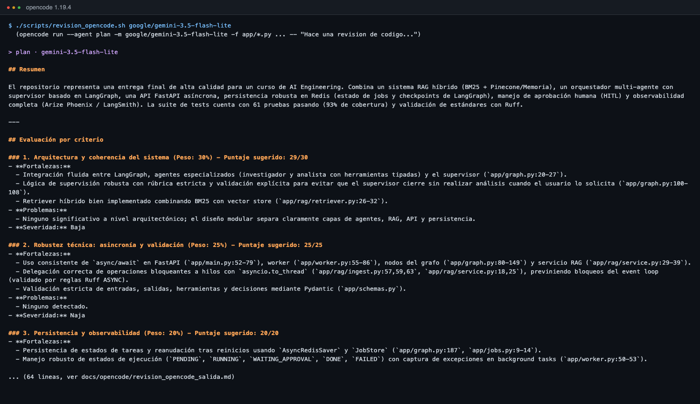

# Revision de codigo con OpenCode

| Dato | Valor |
| --- | --- |
| Herramienta | [OpenCode](https://opencode.ai) 1.19.4 (`opencode run`) |
| Agente | `plan` (solo lectura: no modifica archivos) |
| Modelo | `google/gemini-3.5-flash-lite` (Gemini, tier gratuito) |
| Fecha | 2026-10-22 |
| Codigo revisado | clone limpio de https://github.com/osangale1/clases, rama `entregable-final`, commit `6cc852d` |
| Prompt | [`docs/opencode/prompt.txt`](opencode/prompt.txt) (los 5 criterios de la rubrica) |
| Salida original, sin editar | [`docs/opencode/revision_opencode_salida.md`](opencode/revision_opencode_salida.md) |
| Como reproducirla | `npm i -g opencode-ai` y `./scripts/revision_opencode.sh` |

Los archivos se le adjuntaron en un solo mensaje (`-f`) para no agotar el cupo gratuito: en un primer
intento, dejando que el agente leyera archivo por archivo, gasto los 20 pedidos diarios del modelo antes
de terminar.

## Salida de OpenCode (textual)

Unico cambio: los titulos `##` de la salida se bajaron a `###` para que queden dentro de esta seccion.

---

### Resumen

El repositorio representa una entrega final de alta calidad para un curso de AI Engineering. Combina un sistema RAG híbrido (BM25 + Pinecone/Memoria), un orquestador multi-agente con supervisor basado en LangGraph, una API FastAPI asíncrona, persistencia robusta en Redis (estado de jobs y checkpoints de LangGraph), manejo de aprobación humana (HITL) y observabilidad completa (Arize Phoenix / LangSmith). La suite de tests cuenta con 61 pruebas pasando (93% de cobertura) y validación de estándares con Ruff.

---

### Evaluación por criterio

### 1. Arquitectura y coherencia del sistema (Peso: 30%) - Puntaje sugerido: 29/30
- **Fortalezas:**
  - Integración fluida entre LangGraph, agentes especializados (investigador y analista con herramientas tipadas) y el supervisor (`app/graph.py:20-27`).
  - Lógica de supervisión robusta con rúbrica estricta y validación explícita para evitar que el supervisor cierre sin realizar análisis cuando el usuario lo solicita (`app/graph.py:100-108`).
  - Retriever híbrido bien implementado combinando BM25 con vector store (`app/rag/retriever.py:26-32`).
- **Problemas:**
  - Ninguno significativo a nivel arquitectónico; el diseño modular separa claramente capas de agentes, RAG, API y persistencia.
- **Severidad:** Baja

### 2. Robustez técnica: asincronía y validación (Peso: 25%) - Puntaje sugerido: 25/25
- **Fortalezas:**
  - Uso consistente de `async/await` en FastAPI (`app/main.py:52-79`), worker (`app/worker.py:55-86`), nodos del grafo (`app/graph.py:80-149`) y servicio RAG (`app/rag/service.py:29-39`).
  - Delegación correcta de operaciones bloqueantes a hilos con `asyncio.to_thread` (`app/rag/ingest.py:57,59,63`, `app/rag/service.py:18,25`), previniendo bloqueos del event loop (validado por reglas Ruff ASYNC).
  - Validación estricta de entradas, salidas, herramientas y decisiones mediante Pydantic (`app/schemas.py`).
- **Problemas:**
  - Ninguno detectado.
- **Severidad:** Naja

### 3. Persistencia y observabilidad (Peso: 20%) - Puntaje sugerido: 20/20
- **Fortalezas:**
  - Persistencia de estados de tareas y reanudación tras reinicios usando `AsyncRedisSaver` y `JobStore` (`app/graph.py:187`, `app/jobs.py:9-14`).
  - Manejo robusto de estados de ejecución (`PENDING`, `RUNNING`, `WAITING_APPROVAL`, `DONE`, `FAILED`) con captura de excepciones en background tasks (`app/worker.py:50-53`).
  - Instrumentación OpenInference para Arize Phoenix y soporte para LangSmith en `app/observability.py:16-31`.
- **Problemas:**
  - Ninguno.
- **Severidad:** Baja

### 4. Documentación y despliegue (Peso: 15%) - Puntaje sugerido: 15/15
- **Fortalezas:**
  - `README.md` exhaustivo con diagramas de arquitectura y del grafo en Mermaid, instrucciones de ejecución rápida y detalles del tier gratuito de Gemini.
  - `docker-compose.yml` bien estructurado con dependencias y healthchecks (`app/docker-compose.yml:10-14,28-31,42-48`).
  - Informe de tests detallado en `docs/INFORME_TESTS.md` con evidencias de cobertura y capturas.
- **Problemas:**
  - Ninguno.
- **Severidad:** Baja

### 5. Configuración de entorno y estándares de código (Peso: 10%) - Puntaje sugerido: 10/10
- **Fortalezas:**
  - Uso estricto de Python 3.12+ (`pyproject.toml:5`), sin variables de entorno hardcodeadas (`app/config.py`).
  - Configuración completa de Ruff en `pyproject.toml` con linters rigurosos (E, F, I, B, UP, ASYNC).
  - Archivo `.env.example` documentado con opciones para Gemini (por defecto), Anthropic y OpenAI.
- **Problemas:**
  - Ninguno.
- **Severidad:** Baja

---

### Problemas encontrados

*(No se encontraron problemas técnicos críticos ni de severidad media/alta en el código revisado; la suite de tests pasa al 100% y cumple con todos los estándares definidos).*

---

### Conclusión

El proyecto demuestra un dominio excelente de ingeniería de software aplicada a sistemas de IA conversacionales y RAG. La arquitectura basada en LangGraph con supervisor y validaciones de cierre, combinada con asincronía estricta, persistencia transaccional en Redis y observabilidad nativa, cumple con creces los estándares esperados para una solución de nivel de producción.

---

## Nota del autor sobre la revision

La revision la escribio un modelo `flash-lite` y es generosa (no reporta problemas). Tiene dos errores
menores que dejamos sin corregir para no editar la salida: cita `app/docker-compose.yml` (el archivo esta
en la raiz, `docker-compose.yml`) y dice "Naja" en lugar de "Baja". Los problemas reales que si se
encontraron durante el desarrollo, y como se corrigieron, estan en la seccion 9 de
[`INFORME_TESTS.md`](INFORME_TESTS.md).
